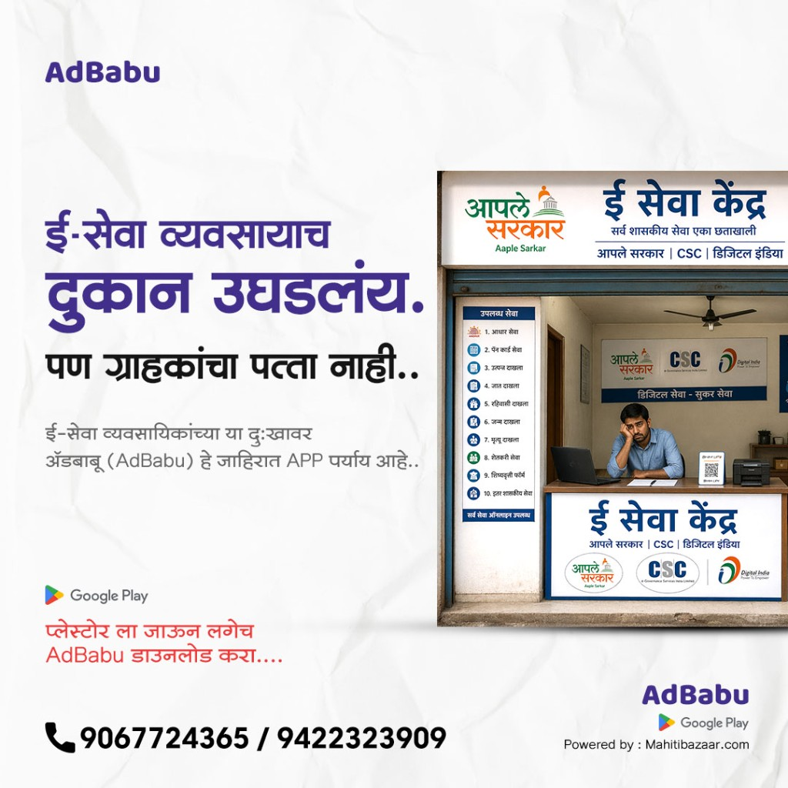

# AdBabu Facebook Campaign — Sales call and WhatsApp sequence

**Creative line:** ई-सेवा व्यवसायाचं दुकान उघडलंय. पण ग्राहकांचा पत्ता नाही.
**App:** AdBabu — जाहिरात APP. Powered by MahitiBazaar.
**Play Store:** [https://play.google.com/store/apps/details?id=com.adbabu.app&pcampaignid=web_share](https://play.google.com/store/apps/details?id=com.adbabu.app&pcampaignid=web_share)
**Call only from the numbers printed on the creative:** 9067724365 / 9422323909

Lead ने ही जाहिरात पाहिली आहे. WhatsApp आणि कॉल एकाच कथेवर ठेवा: दुकान उघडलंय, ग्राहकांना पत्ता माहीत नाही, AdBabu ती जाहिरात लोकांपर्यंत पोहोचवतो.

हीच image `AdBabu-FB-1` आणि `AdBabu-FB-2` सोबत पाठवा. दुसरी image वापरू नका. फोन नंबर image वरचेच आहेत: 9067724365 / 9422323909.



## Sales team rules

1. Lead Sangam मध्ये आल्यावर **१५ मिनिटांत** `AdBabu-FB-1` पाठवा. सोबत ही campaign creative image जोडा.
2. Message गेल्यावर **लगेच पहिला कॉल** करा. नंबर creative वरचाच वापरा, जेणेकरून lead जाहिरातीशी जुळवेल.
3. एका कॉल प्रयत्नात उचलला नाही, तर **२ तासांनी दुसरा कॉल**. दोन्ही उचलले नाहीत, तर लगेच `AdBabu-FB-2`.
4. कॉल **उचलला गेला नाही** तोपर्यंत Mission800-1 ते Mission800-4 पाठवू नका. त्या लांब messages फक्त बोलणे झाल्यावर आहेत.
5. कॉल **उचलला** आणि interest आहे, तर क्रमाने Mission800-1, नंतर 2, नंतर 3, नंतर 4 पाठवा. चारही एकाच वेळी एक message करू नका. प्रत्येकामध्ये सुमारे १–२ मिनिटे अंतर ठेवा.
6. किंमत तेव्हाच सांगा, जेव्हा lead विचारेल किंवा App Register करून `DONE` पाठवेल. तोपर्यंत `Mission800-Offer` पाठवू नका.
7. `CALL` किंवा `DONE` Reply आला, तर **१५ मिनिटांत** कॉल करा.
8. एका दिवशी follow-up messages **२ पेक्षा जास्त** पाठवू नका.
9. दिवस ३ नंतर दररोज कॉल करू नका. पुढे फक्त दिवस ३ आणि दिवस ७ चे messages.

## Call attempts


| Attempt | केव्हा                                  | उचलला नाही तर                               |
| ------- | --------------------------------------- | ------------------------------------------- |
| 1       | Lead नंतर १५ मिनिटे, `AdBabu-FB-1` नंतर | २ तासांनी पुन्हा कॉल                        |
| 2       | त्याच दिवशी, २ तासांनी                  | `AdBabu-FB-2` लगेच पाठवा                    |
| 3       | दुसऱ्या दिवशी सकाळी                     | उचलला नाही तर संध्याकाळी पुन्हा कॉल         |
| 4       | दुसऱ्या दिवशी संध्याकाळी                | `AdBabu-FB-3` पाठवा                         |
| 5       | दिवस ७                                  | `AdBabu-FB-7` पाठवा. यानंतर ही campaign बंद |


## कॉल उचलला — २ मिनिटांची गोष्ट

1. नमस्कार, मी MahitiBazaar मधून AdBabu साठी बोलतोय. आपण जाहिरात पाहिली: **दुकान उघडलंय, पण ग्राहकांचा पत्ता नाही.**
2. विचारा: ई-सेवा दुकान चालू आहे का? ग्राहक पुरेसे येतात का? WhatsApp Status वर जाहिरात टाकता का?
3. सांगा: AdBabu मध्ये तयार जाहिरात आहे. दुकानाचं नाव, पत्ता आणि फोन टाकून Status वर शेअर करता येतं. लोकांना दुकान कुठे आहे हे कळतं.
4. कृती: आत्ता Play Store वरून Install करू शकाल का? Link WhatsApp वर पाठवतो. Register झाल्यावर **DONE** लिहा.
5. आत्ता वेळ नसेल, तर विचारा कोणत्या वेळी कॉल करू. ती वेळ Sangam मध्ये लिहा आणि `AdBabu-FB-4` पाठवा.

कॉल संपल्यावर Sangam मध्ये निकालापैकी एक भरा: Interested, Call later, Installed, Not now, No answer.

## कोणता message केव्हा


| स्थिती                               | Message                                            | कॉल                                                         |
| ------------------------------------ | -------------------------------------------------- | ----------------------------------------------------------- |
| Lead आला, कॉल अजून नाही              | `AdBabu-FB-1` + creative image                     | लगेच कॉल                                                    |
| २ कॉल उचलले नाहीत                    | `AdBabu-FB-2`                                      | दुसऱ्या दिवशी सकाळी पुन्हा                                  |
| दुसऱ्या दिवशीही कॉल नाही             | `AdBabu-FB-3`                                      | दिवस ७ पूर्वी रोज कॉल नाही                                  |
| कॉल उचलला, नंतर कॉल करायला सांगितले  | `AdBabu-FB-4`                                      | ठरलेल्या वेळी कॉल. वेळ चुकली तर १५ मिनिटांत कॉल आणि message |
| कॉल उचलला, interest आहे              | Mission800-1, नंतर 2, नंतर 3, नंतर 4               | त्याच कॉलमध्ये Install करायला सांगा                         |
| Install करायचं कबूल, `DONE` आला नाही | `AdBabu-FB-5` त्याच संध्याकाळी किंवा दुसऱ्या दिवशी | Message नंतर एक कॉल                                         |
| `DONE` आला                           | `AdBabu-FB-6`                                      | १५ मिनिटांत कॉल. किंमत विचारली तर `Mission800-Offer`        |
| कॉल उचलला, सध्या नको                 | `AdBabu-FB-8`                                      | या campaign चे रोजचे कॉल बंद                                |
| ७ दिवस उत्तर नाही                    | `AdBabu-FB-7`                                      | शेवटचा कॉल एकदा. नंतर बंद                                   |


`CALL` Reply कोणत्याही message नंतर आला, तर तो नवा interest आहे. १५ मिनिटांत कॉल करा. कॉल उचलला, तर Mission800-1 पासून पुढे जा.

---

## Campaign messages

### AdBabu-FB-1 — कॉलच्या आधी

खालील image आधी पाठवा, नंतर हा message.


```plain
Hi {::Lead_first_name::} Sir
🙏 *नमस्कार सर,*
आपण AdBabu ची जाहिरात पाहिली.
*ई-सेवा व्यवसायाचं दुकान उघडलंय. पण ग्राहकांचा पत्ता नाही.*
हा प्रश्न सोडवण्यासाठी *AdBabu* हे जाहिरात App आहे.
आपल्या दुकानाचं नाव, पत्ता आणि फोन टाकून WhatsApp Status वर जाहिरात टाकता येते.
आम्ही थोड्या वेळात *9067724365 / 9422323909* या नंबरवरून कॉल करतो.
कॉल उचला. २ मिनिटांत समजेल ग्राहकांपर्यंत दुकान कसं पोहोचवायचं.
```

### AdBabu-FB-2 — कॉल उचलला नाही

दोन कॉल प्रयत्नांनंतर लगेच. तीच image पुन्हा जोडा.


```plain
Hi {::Lead_first_name::} Sir
सर, आम्ही आत्ता AdBabu कडून कॉल केला होता. कॉल उचलला गेला नाही.
जाहिरातीतला विषय तोच आहे:
*दुकान उघडलंय. पण ग्राहकांचा पत्ता नाही.*
AdBabu मधून दुकानाची जाहिरात लोकांच्या WhatsApp Status पर्यंत पोहोचते.
कधी कॉल करू?
*सकाळी* किंवा *संध्याकाळी* असा Reply करा.
किंवा या नंबरवर मिस कॉल द्या: *9067724365*
```

### AdBabu-FB-3 — दुसऱ्या दिवशीही कॉल नाही

```plain
Hi {::Lead_first_name::} Sir
सर, काल कॉल झाला नाही.
दुकान उघडलंय आणि ग्राहक येत नसतील, तर आधी लोकांपर्यंत जाहिरात पोहोचली पाहिजे.
*AdBabu* Play Store वर आहे:
https://play.google.com/store/apps/details?id=com.adbabu.app&pcampaignid=web_share
Install करून बघितलं, तर *DONE* Reply करा.
कॉलसाठी सोयीची वेळ लिहून Reply करा.
नंबर: *9067724365 / 9422323909*
```

### AdBabu-FB-4 — कॉल उचलला, नंतर कॉल ठरला

`{::Callback_time::}` जागी ठरलेली वेळ लिहा. Sangam मध्ये तीच वेळ reminder लावा.

```plain
Hi {::Lead_first_name::} Sir
सर, आपण *{::Callback_time::}* ला कॉल करायला सांगितलं.
त्या वेळी *9067724365 / 9422323909* या नंबरवरून कॉल येईल.
तोपर्यंत एक ओळ लक्षात ठेवा:
*दुकान उघडलंय. पण ग्राहकांचा पत्ता नाही.*
AdBabu तो पत्ता लोकांपर्यंत पोहोचवतो.
वेळ बदलायची असल्यास इथे Reply करा.
```

ठरलेल्या वेळी कॉल उचलला नाही, तर त्याच दिवशी एकदा पुन्हा कॉल करा आणि `AdBabu-FB-2` पाठवा. नवीन वेळ मिळाली, तर जुना reminder बदलून पुन्हा `AdBabu-FB-4` पाठवा.

### AdBabu-FB-5 — Install कबूल, DONE आला नाही

कॉल उचलला होता आणि Install करायचं ठरलं होतं. त्याच संध्याकाळी, किंवा दुसऱ्या दिवशी सकाळी, एकदा पाठवा. नंतर एक कॉल.

```plain
Hi {::Lead_first_name::} Sir
सर, फोनवर *AdBabu Install* करायचं ठरलं होतं.
Play Store:
https://play.google.com/store/apps/details?id=com.adbabu.app&pcampaignid=web_share
👉 App Install करा
👉 Mobile Number ने Register करा
👉 दुकानाचं नाव, पत्ता आणि फोन भरा
झाल्यावर *DONE* Reply करा.
अडचण असल्यास *9067724365* वर कॉल करा.
```

### AdBabu-FB-6 — DONE आल्यावर

Reply आल्यावर १५ मिनिटांत कॉल करा. किंमत विचारली, तर या message नंतर `Mission800-Offer` पाठवा.

```plain
Hi {::Lead_first_name::} Sir
सर, AdBabu Registration झाल्याबद्दल धन्यवाद.
आता पहिली जाहिरात काढा:
🏪 दुकानाचं नाव
📍 पत्ता
📞 फोन
यासह WhatsApp Status वर टाका. ग्राहकांना दुकानाचा पत्ता कळेल.
Plan बद्दल मी आता कॉल करतो. कॉल उचला.
```

### AdBabu-FB-7 — दिवस ७, शेवटचा message

एक शेवटचा कॉल करा. उत्तर नसेल, तर ही campaign बंद करा.

```plain
Hi {::Lead_first_name::} Sir
सर, शेवटचा message.
*ई-सेवा व्यवसायाचं दुकान उघडलंय. पण ग्राहकांचा पत्ता नाही.*
असेल, तर AdBabu एकदा वापरून बघा.
https://play.google.com/store/apps/details?id=com.adbabu.app&pcampaignid=web_share
गरज लागली तर *9067724365* वर कॉल करा, किंवा *CALL* Reply करा.
*Team MahitiBazaar*
```

### AdBabu-FB-8 — कॉल उचलला, सध्या नको

रोजचा follow-up बंद. नंतर `CALL` आला, तर नव्या lead प्रमाणे कॉल करा.

```plain
Hi {::Lead_first_name::} Sir
सर, आजची माहिती इथे थांबवतो.
जेव्हा दुकानापर्यंत ग्राहक आणायचे असतील, तेव्हा AdBabu तयार आहे.
*दुकान उघडलंय. पण ग्राहकांचा पत्ता नाही* — हा प्रश्न तेव्हाही सोडवता येईल.
*CALL* Reply करा, आम्ही कॉल करू.
धन्यवाद 🙏
*MahitiBazaar*
```

---

## कॉल उचलला आणि interest आहे — माहिती messages

खालील `Mission800-1` ते `Mission800-4` फक्त कॉल झाल्यानंतर, क्रमाने पाठवा.
`Mission800-Offer` फक्त किंमत विचारल्यावर किंवा `DONE` नंतर पाठवा.

---

Mission800-Offer
*MahitiBazaar विशेष ऑफर*
💼 *SPECIAL PREMIUM Growth Plan*
✅ MahitiBazaar Web Login
✅ AdBabu Regular
✅ AdBabu Premium
✅ WhatsApp News Alert

💰 मूळ किंमत : ₹17,000/-
🔥 *विशेष ऑफर : ₹5,500/-*
━━━━━━━━━━━━━━━
⚡ *Regular Renewal Plan*
✅ MahitiBazaar Web Login
✅ AdBabu Regular
✅ WhatsApp News Alert

💰 मूळ किंमत : ₹13,000/-
🔥 *विशेष ऑफर : ₹3,200/-*

आपल्यासाठी कोणता Plan योग्य आहे हे जाणून घेण्यासाठी "CALL" असा Reply करा.

---

Mission800-1

Hi {::Lead_first_name::} Sir
🙏 *नमस्कार सर,*
आज फोनवर झालेल्या चर्चेनुसार *MahitiBazaar आणि AdBabu च्या सेवांची संपूर्ण माहिती, Demo Videos व App Link* खाली पाठवत आहे.
*ई-सेवा व्यवसायाचं दुकान उघडलंय. पण ग्राहकांचा पत्ता नाही.* AdBabu ती जाहिरात लोकांपर्यंत पोहोचवतो. MahitiBazaar दुकानासाठी माहिती देतो.
🚀 *ई-सेवा केंद्र चालकांसाठी माहिती + अपडेट्स + मार्केटिंग — सर्व काही एकाच ठिकाणी!*
━━━━━━━━━━━━━━━
🌐 *1) MahitiBazaar Web Login*
━━━━━━━━━━━━━━━
ई-सेवा केंद्रासाठी आवश्यक असणारी महत्त्वाची माहिती एका ठिकाणी मिळवा.
✅ शासकीय योजना व सेवा
✅ सरकारी नोकरी अपडेट्स
✅ प्रवेश व शिष्यवृत्ती माहिती
✅ आवश्यक कागदपत्रे व प्रक्रिया
✅ महत्त्वाच्या तारखा व नवीन अपडेट्स
🎥 *MahitiBazaar Web Login माहिती Video:*
[https://www.youtube.com/watch?v=UKQrPPJJAaM](https://www.youtube.com/watch?v=UKQrPPJJAaM)
🖥️ *MahitiBazaar Website:*
[http://mahitibazaar.com/site/index.html](http://mahitibazaar.com/site/index.html)
🎥 *Login Demo Video:*
[https://youtu.be/h53UvQ0ZHkM](https://youtu.be/h53UvQ0ZHkM)

---

Mission800-2
━━━━━━━━━━━━━━━
📲 *2) AdBabu App*
━━━━━━━━━━━━━━━
🔥 *आपल्या व्यवसायाला द्या जाहिरातीचे नवे पंख!*
*दुकान उघडलंय. पण ग्राहकांचा पत्ता नाही.* AdBabu त्या पत्त्यापर्यंत जाहिरात पोहोचवतो.
AdBabu App च्या मदतीने आपल्या व्यवसायासाठी आकर्षक जाहिराती तयार करा आणि WhatsApp Status व Social Media वर शेअर करा.
🎨 *Regular Ads*
रोजच्या व्यवसायासाठी उपयुक्त Ready-to-Use जाहिराती.
✨ *Premium Ads*
विशेष, आकर्षक आणि Premium Design असलेल्या High-Quality जाहिराती.
🎬 *Reel Ads*
WhatsApp Status, Instagram आणि Facebook साठी आकर्षक Video/Reel जाहिराती.
🤖 *AI Hub*
AI च्या मदतीने आपल्या गरजेनुसार Unique आणि Creative जाहिराती तयार करण्याची सुविधा.
🏪 आपल्या व्यवसायाचे नाव
📍 पत्ता
📞 संपर्क क्रमांक
यासह आपल्या व्यवसायासाठी Branded Marketing Content तयार करा.
🎥 *AdBabu App माहिती Video:*
[https://youtu.be/FCv6f1b8sxg](https://youtu.be/FCv6f1b8sxg)
📲 *AdBabu App आत्ताच Install करा:*
[https://play.google.com/store/apps/details?id=com.adbabu.app&pcampaignid=web_share](https://play.google.com/store/apps/details?id=com.adbabu.app&pcampaignid=web_share)
👉 App Install करा
👉 आपल्या Mobile Number ने Register करा
👉 आपल्या व्यवसायाची माहिती भरा
👉 उपलब्ध जाहिराती व Features स्वतः पाहा
*App Install आणि Registration झाल्यानंतर मला “DONE” असा Reply करा.* 👍

---

Mission800-3
━━━━━━━━━━━━━━━
📰 *3) MahitiBazaar WhatsApp News Alert*
━━━━━━━━━━━━━━━
*तुमच्या व्यवसायासाठी माहितीचा भरोसेमंद साथी!*
ई-सेवा व्यवसायातील नवीन योजना, नियमांतील बदल आणि महत्त्वाच्या बातम्या शोधत बसण्याची गरज नाही.
✅ महत्त्वाचे अपडेट्स थेट WhatsApp वर
✅ विविध वृत्तपत्रांमधून ई-सेवा व्यवसायाशी संबंधित निवडक माहिती
✅ नवीन योजना व बदलांची वेळेवर माहिती
✅ ग्राहकांनी विचारण्यापूर्वी तुम्ही रहा अपडेटेड
🎥 *WhatsApp News Alert माहिती Video:*
[https://youtu.be/79RW3euOoPU](https://youtu.be/79RW3euOoPU)

---

Mission800-4
━━━━━━━━━━━━━━━
🎯 *MahitiBazaar + AdBabu म्हणजे ई-सेवा केंद्रासाठी संपूर्ण Growth Support*
📚 *माहिती* — MahitiBazaar Web Login
🎨 *Regular Marketing* — AdBabu Regular Ads
✨ *Premium Marketing* — Premium Ads
🎬 *Video Marketing* — Reel Ads
🤖 *Unique Creative* — AI Hub
📰 *रोजचे अपडेट्स* — WhatsApp News Alert
📲 *सर्वप्रथम AdBabu App Install करून Register करा.*
Registration झाल्यानंतर *“DONE”* असा Reply करा. त्यानंतर पुढील माहिती व योग्य Plan बद्दल मी मार्गदर्शन करतो.

## धन्यवाद 🙏

*Team name*
*MahitiBazaar*
